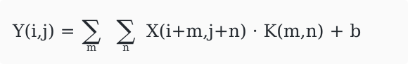
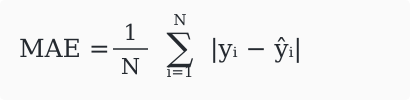
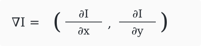
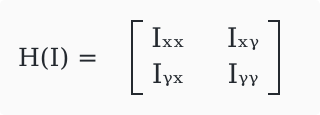
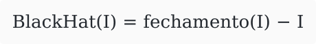

<div align="center">
  <h1>Ocre Studio</h1>
  <p><strong>Archaeological Imaging &amp; AI</strong></p>
  <p>
    <em>Software desktop para processamento digital, realce cromático e análise estrutural de registros rupestres.</em>
  </p>
  <p>
    
    
    
    
  </p>
</div>

<hr />

<p>
  O <strong>Ocre Studio</strong> é um software desktop voltado ao processamento digital, realce cromático e análise estrutural de fotografias de registros rupestres. O projeto reúne algoritmos clássicos de visão computacional e modelos de aprendizado profundo treinados especificamente para auxiliar pesquisadores na visualização de pigmentos, pinturas e gravuras sobre superfícies rochosas — elementos que muitas vezes apresentam baixo contraste ou desgaste acentuado nas imagens brutas.
</p>

<p>
  Desenvolvido por <strong>Marinaldo da Costa Barroso Filho</strong>, graduando em Ciência da Computação pela Universidade Federal de Rondônia (UNIR), o software nasce da interseção entre computação aplicada e pesquisa arqueológica.
</p>

<hr />

<h2>Contexto e Motivação</h2>

<p>
  O registro fotográfico é parte central da documentação de sítios arqueológicos. Na prática, porém, a leitura visual de grafismos rupestres costuma ser dificultada por iluminação irregular, intemperismo, alterações cromáticas da rocha e baixa diferenciação entre pigmento e substrato.
</p>

<p>
  Para contornar essas limitações, pesquisadores frequentemente recorrem a múltiplas ferramentas isoladas para ajustar canais, aplicar filtros morfológicos ou gerar falsas cores. O Ocre Studio busca centralizar esse fluxo em um ambiente único, não destrutivo e voltado à análise exploratória.
</p>

<blockquote>
  <p>
    <strong>Premissa metodológica:</strong> O software não substitui o olhar técnico do arqueólogo nem reconstrói informações ausentes. Ele atua como instrumento de suporte visual para evidenciar padrões latentes que exigem validação em campo e cruzamento com outras evidências materiais.
  </p>
</blockquote>

<hr />

<h2>Escopo e Estado Atual do Projeto</h2>

<p>
  O Ocre Studio encontra-se em <strong>fase alfa</strong> (<code>v0.1.0-alpha.2</code>) e em desenvolvimento contínuo. Para clareza metodológica, o escopo atual divide-se em três frentes:
</p>

<h3>1. Implementado e Integrado</h3>
<ul>
  <li><strong>Pipeline de realce:</strong> Realce cromático, adaptativo, estrutural, combinado e visualizações em falsa cor.</li>
  <li><strong>Modelos neurais nativos:</strong> Inferência local integrada dos modelos <strong>Kokentau</strong> (<code>Grade</code>, <code>AdaptiveV7</code> e o pipeline híbrido <code>Kokentau V8.2</code>), sem necessidade de configuração manual de checkpoints nas distribuições completas.</li>
  <li><strong>Processamento digital de imagens:</strong> Ajustes de brilho, contraste e saturação; morfologia matemática (<em>Top Hat</em> e <em>Black Hat</em>); filtros de Gabor; análise via matrizes Hessianas; histogramas e decomposição de canais RGB.</li>
  <li><strong>Análise localizada:</strong> Delimitação de Regiões de Interesse (ROI) com preservação integral dos pixels externos à área selecionada.</li>
  <li><strong>Ambiente de trabalho:</strong> Gerenciamento por projetos, visualização em abas, comparação lado a lado (original vs. processada), histórico de operações com registro de parâmetros e exportação não destrutiva.</li>
</ul>

<h3>2. Experimental (Em Validação)</h3>
<ul>
  <li><strong>Generalização em campo:</strong> Avaliação sistemática do desempenho dos modelos em fotografias de diferentes sítios arqueológicos, condições de iluminação e suportes rochosos.</li>
  <li><strong>Otimização de escala:</strong> Ajustes de consumo de memória e tempo de inferência para imagens de alta resolução e lotes extensos.</li>
</ul>

<h3>3. Planejado (Roadmap)</h3>
<ul>
  <li><strong>Segmentação de superfícies:</strong> Investigação de arquiteturas de segmentação neural (incluindo integração experimental com <em>SAM2</em>).</li>
  <li><strong>Restauração auxiliar:</strong> Módulos opcionais para redução de ruído e correção de artefatos ópticos.</li>
  <li><strong>Reprodutibilidade:</strong> Exportação padronizada de relatórios técnicos contendo metadados, máscaras de ROI e parâmetros de execução.</li>
</ul>

<hr />

<h2>Arquitetura Computacional e Modelos Kokentau</h2>

<p>
  O núcleo neural do Ocre Studio baseia-se nos experimentos <strong>Kokentau</strong>, conduzidos a partir de registros fotográficos do conjunto arqueológico homônimo e suas respectivas referências de realce em falsa cor. A abordagem utiliza aprendizado supervisionado focado em transformações cromáticas espacialmente adaptativas e preservação de bordas.
</p>

<table>
  <thead>
    <tr>
      <th align="left">Componente</th>
      <th align="left">Abordagem Técnica</th>
      <th align="left">Papel no Pipeline</th>
    </tr>
  </thead>
  <tbody>
    <tr>
      <td><strong>Grade</strong> <em>(época 75)</em></td>
      <td>Transformação RGB afim via grade bilateral</td>
      <td>Realce cromático local sensível a variações espaciais da rocha.</td>
    </tr>
    <tr>
      <td><strong>AdaptiveV7</strong> <em>(época 42)</em></td>
      <td>Mistura de 4 especialistas + resíduo convolucional</td>
      <td>Adaptação dinâmica à variabilidade cromática e textural.</td>
    </tr>
    <tr>
      <td><strong>Kokentau V8.2</strong></td>
      <td>Pipeline híbrido (modelos + operadores clássicos)</td>
      <td>Combina a resposta do operador mascarado (40%) e do <code>AdaptiveV7</code> (60%) com intensidade padrão de <code>0,85</code>.</td>
    </tr>
    <tr>
      <td><strong>Top Hat / Black Hat</strong></td>
      <td>Morfologia matemática</td>
      <td>Isolamento de estruturas localmente claras ou escuras em relação ao entorno.</td>
    </tr>
    <tr>
      <td><strong>Matrizes Hessianas</strong></td>
      <td>Análise diferencial de segunda ordem</td>
      <td>Resposta a estruturas lineares, sulcos e curvaturas superficiais.</td>
    </tr>
    <tr>
      <td><strong>Filtros de Gabor</strong></td>
      <td>Filtragem espacial orientada</td>
      <td>Caracterização de texturas e direcionalidade de traços.</td>
    </tr>
  </tbody>
</table>

<h3>Fluxo de Processamento</h3>

<pre><code>Fotografia Original
        │
        ▼
Preparação RGB &amp; Definição de ROI
        │
        ├────────────────────────────┐
        ▼                            ▼
  Realce Cromático           Análise Estrutural
(Grade + AdaptiveV7)    (Morfologia, Hessiana, Gabor)
        │                            │
        └─────────────┬──────────────┘
                      ▼
           Pipeline Kokentau V8.2
                      │
                      ▼
       Imagem Processada &amp; Comparação</code></pre>

<hr />

## Fundamentos Matemáticos

As operações implementadas no software apoiam-se nas seguintes formulações:

### Convolução bidimensional

Extração de mapas de características espaciais e cromáticas nas camadas convolucionais:



Onde **X** representa a entrada, **K** o kernel aprendido e **b** o termo de polarização (*bias*).

### Erro de reconstrução (MAE)

Minimização da diferença absoluta média entre a saída prevista (ŷᵢ) e a referência de treinamento (yᵢ):



### Similaridade estrutural (SSIM)

Avaliação conjunta de luminância, contraste e estrutura espacial para evitar distorções geométricas durante o realce.

### Aprendizado residual

Modelagem de uma função corretiva R(X) somada à entrada original, preservando a integridade estrutural da imagem base:


### Gradientes espaciais e matriz Hessiana

O gradiente orienta a preservação de bordas:



As derivadas parciais de segunda ordem compõem a matriz Hessiana para detecção de estruturas lineares:



### Operadores morfológicos

Extração de detalhes locais de luminância por meio da diferença entre a imagem original I e suas transformações de abertura e fechamento.

**Top Hat:**


**Black Hat:**



<hr />

<h2>Verificação Numérica</h2>

<p>
  Para assegurar que a integração dos modelos ao ambiente desktop reproduz fielmente os experimentos originais, o pipeline foi submetido a um teste de equivalência numérica contra a implementação de referência do <strong>Kokentau V8.2</strong>:
</p>

<ul>
  <li><strong>Configuração do teste:</strong> Execução em CPU, imagem sintética RGB de <code>176 × 140</code> pixels, semente aleatória <code>42</code>, ROI retangular, intensidade <code>0,85</code> e blocos de <code>64</code> pixels.</li>
  <li><strong>Resultado:</strong> Igualdade exata pixel a pixel nas 11 saídas avaliadas e preservação integral dos pixels externos à ROI, com tempo de inferência de aproximadamente <code>0,26 s</code> (desconsiderando o carregamento inicial dos pesos).</li>
</ul>

<blockquote>
  <p>
    <strong>Nota:</strong> Esse teste atesta a consistência computacional da implementação, mas não constitui validação arqueológica nem comprovação de generalização para fotografias reais de campo.
  </p>
</blockquote>

<hr />

<h2>Engenharia de Software e Stack Tecnológica</h2>

<p>
  O Ocre Studio é construído em <strong>Python</strong> sobre o <a href="https://github.com/zxlawdx/Vela-framework">Vela Framework</a> — runtime desktop também desenvolvido pelo autor que permite estruturar interfaces modernas com tecnologias web sem depender da sobrecarga de memória do Electron. Todo o processamento ocorre localmente, sem envio de imagens a servidores externos.
</p>

<table>
  <thead>
    <tr>
      <th align="left">Camada</th>
      <th align="left">Tecnologias</th>
    </tr>
  </thead>
  <tbody>
    <tr>
      <td><strong>Core e Inferência</strong></td>
      <td>Python 3.12, PyTorch (CPU/CUDA), NumPy, SciPy</td>
    </tr>
    <tr>
      <td><strong>Visão Computacional</strong></td>
      <td>OpenCV, Pillow</td>
    </tr>
    <tr>
      <td><strong>Interface e Runtime</strong></td>
      <td>Vela Framework, HTML5, CSS3, JavaScript, PyWebView (WebView2 no Windows / WebKitGTK no Linux)</td>
    </tr>
    <tr>
      <td><strong>Empacotamento e CI</strong></td>
      <td>PyInstaller, Inno Setup, GitHub Actions</td>
    </tr>
  </tbody>
</table>

<p>
  A organização da interface segue as heurísticas de usabilidade de Jakob Nielsen, buscando abstrair a complexidade dos tensores e hiperparâmetros por trás de ferramentas diretamente associadas à rotina de análise visual do pesquisador.
</p>

<hr />

<h2>Instalação e Uso</h2>

<h3>Distribuições Pré-compiladas</h3>

<p>Os binários para sistemas de 64 bits estão disponíveis na página de <a href="https://github.com/zxlawdx/ocre-studio/releases">Releases</a>:</p>

<ul>
  <li><strong>Windows:</strong> Instalador <code>Setup.exe</code> ou pacote portátil <code>.zip</code> (requer <em>Microsoft Edge WebView2 Runtime</em>).</li>
  <li><strong>Linux:</strong> Pacotes <code>.deb</code> (Linux Mint, Zorin OS, Ubuntu e Debian), <code>.rpm</code> (Fedora), instalador <code>.run</code>, AppImage ou ZIP portátil.</li>
</ul>

#### Linux Mint, Zorin OS e Fedora pelo terminal

Os comandos abaixo são para Linux x86-64. Eles baixam o pacote da versão mais recente publicada do Ocre Studio, incluindo pré-lançamentos, e conferem o SHA-256 antes de instalar. Rode os blocos no mesmo terminal Bash.

Instale as ferramentas de download da sua distribuição.

```bash
# Linux Mint ou Zorin OS
sudo apt update && sudo apt install curl jq
```

```bash
# Fedora
sudo dnf install jq /usr/bin/curl
```

Cole esta função no terminal.

```bash
instalar_ocre() (
    set -euo pipefail
    formato=$1
    shift
    pasta=$(mktemp -d)
    trap 'rm -rf -- "$pasta"' EXIT
    chmod 755 "$pasta"
    cd "$pasta"

    url=$(
        curl -fsSL 'https://api.github.com/repos/zxlawdx/ocre-studio/releases?per_page=100' |
        jq -er --arg formato "$formato" '
            map(select(.draft == false and (.tag_name | test("^v[0-9]"))))
            | max_by(.published_at)
            | .assets[]
            | select(.state == "uploaded" and (.name | startswith("ocre-studio")))
            | select(.name | endswith($formato))
            | .browser_download_url
        '
    )
    pacote=${url##*/}
    curl -fsSL -o "$pacote" "$url"
    curl -fsSL -o "$pacote.sha256" "$url.sha256"
    sha256sum -c "$pacote.sha256"
    "$@" "./$pacote"
)
```

Rode o comando correspondente à sua distribuição e abra o **Ocre Studio** pelo menu de aplicativos.

```bash
# Linux Mint ou Zorin OS
instalar_ocre .deb sudo apt install
```

```bash
# Fedora
instalar_ocre .rpm sudo dnf install
```

Os pacotes exigem GTK 3 e WebKitGTK 4.1, instalados pelo gerenciador de pacotes quando disponíveis nos repositórios da distribuição.

<p>
  <em>Nota: As distribuições padrão incluem o PyTorch configurado para execução em CPU. O uso de aceleração via GPU (CUDA) está disponível apenas em ambiente de desenvolvimento com drivers e dependências configurados.</em>
</p>

<h3>Execução a partir do Código-Fonte</h3>

<ol>
  <li>
    <p><strong>Clone o repositório e configure o ambiente virtual:</strong></p>
    <pre><code class="language-bash">git clone https://github.com/zxlawdx/ocre-studio.git
cd ocre-studio
python3.12 -m venv .venv
source .venv/bin/activate  # No Windows: .\.venv\Scripts\Activate.ps1</code></pre>
  </li>
  <li>
    <p><strong>Instale as dependências:</strong></p>
    <pre><code class="language-bash">python -m pip install --upgrade pip
pip install -r requirements.txt -r requirements-dev.txt -r requirements-torch.txt</code></pre>
  </li>
  <li>
    <p><strong>Provisione os modelos e recursos estáticos:</strong></p>
    <pre><code class="language-bash">python -m tools.provision_kokentau PACOTE_V7.zip PACOTE_V8.zip
python manage.py collectstatic --yes
python manage.py assets verify</code></pre>
  </li>
  <li>
    <p><strong>Inicie a aplicação:</strong></p>
    <pre><code class="language-bash">python manage.py runapp</code></pre>
  </li>
</ol>

<details>
  <summary><strong>Suíte de Testes e Build (Clique para expandir)</strong></summary>
  <br />
  <pre><code class="language-bash"># Testes unitários e de geometria de ROI
python -m pytest -q
node --test tests/roi.test.mjs

# Verificação de integridade do framework e interface
python -m tools.patch_vela_self_test
python manage.py self-test
python -m tools.smoke_gui --native --workspace

# Diagnóstico e empacotamento
python manage.py doctor
python manage.py buildapp --installer</code></pre>
</details>

<hr />

<h2>Limitações Científicas</h2>

<p>O uso do Ocre Studio em pesquisa exige rigor metodológico quanto ao alcance das técnicas empregadas:</p>

<ol>
  <li><strong>Ausência de prova material isolada:</strong> Um realce digital não comprova a existência de pigmento ou intervenção antrópica; alterações minerais naturais, líquens e sombras podem produzir respostas visuais semelhantes.</li>
  <li><strong>Natureza das falsas cores:</strong> As representações cromáticas geradas pelos modelos expressam contrastes matemáticos aprendidos, não correspondendo à composição química ou à cor original dos materiais.</li>
  <li><strong>Ausência de métrica tridimensional:</strong> Mapas estruturais derivados de matrizes Hessianas ou filtros de Gabor operam sobre luminância 2D e não substituem levantamentos fotogramétricos ou escaneamento a laser para medição de profundidade de gravuras.</li>
  <li><strong>Dependência da aquisição:</strong> A qualidade das saídas está diretamente condicionada à resolução, foco, balanço de branco e iluminação da fotografia original.</li>
</ol>

<hr />

<h2>Autoria e Transparência no Desenvolvimento</h2>

<p>
  A concepção do projeto, a investigação das arquiteturas neurais, a condução dos experimentos de treinamento e a implementação do Ocre Studio foram realizadas por <strong>Marinaldo da Costa Barroso Filho</strong> (Ciência da Computação — UNIR).
</p>

<p>
  Em conformidade com boas práticas de transparência acadêmica, registra-se que ferramentas de inteligência artificial generativa foram empregadas durante o desenvolvimento como suporte auxiliar para refatoração de código, estruturação de testes e revisão documental. Todas as decisões arquiteturais, escolhas matemáticas, curadoria de dados e validações técnicas foram conduzidas e verificadas pelo autor.
</p>

<p>
  O projeto apoia-se em bibliotecas de código aberto e fundamentos científicos consolidados na literatura de processamento de imagens e aprendizado de máquina, cujos créditos pertencem aos seus respectivos autores.
</p>

<hr />

<h2>Como Citar</h2>

<p>
  Caso utilize o Ocre Studio em publicações ou relatórios técnicos, informe a versão do software, o modelo empregado e os parâmetros aplicados às imagens.
</p>

<pre><code class="language-bibtex">@software{barroso2026ocre,
  author  = {Barroso Filho, Marinaldo da Costa},
  title   = {Ocre Studio: Archaeological Imaging and AI},
  year    = {2026},
  version = {0.1.0-alpha.2},
  url     = {https://github.com/zxlawdx/ocre-studio},
  note    = {Software para processamento digital e realce de imagens arqueológicas}
}</code></pre>

<p><strong>Referência (ABNT):</strong></p>
<blockquote>
  <p>
    BARROSO FILHO, Marinaldo da Costa. <strong>Ocre Studio</strong>: software para processamento digital e realce de imagens arqueológicas com aprendizado profundo. Versão 0.1.0-alpha.2. Porto Velho: UNIR, 2026. Disponível em: <a href="https://github.com/zxlawdx/ocre-studio">https://github.com/zxlawdx/ocre-studio</a>.
  </p>
</blockquote>

<hr />

<h2>Licenciamento</h2>

<p>
  O Ocre Studio é distribuído conforme os <a href="assets/legal/TERMOS-DE-USO.txt">termos de uso do aplicativo</a>. Os direitos de comercialização são reservados ao titular. Bibliotecas, modelos, fotografias e outros componentes de terceiros mantêm suas próprias condições.
</p>

<hr />

<div align="center">
  <p><strong>Contato e Repositórios</strong></p>
  <p>
    <strong>Autor:</strong> Marinaldo da Costa Barroso Filho (<a href="https://github.com/zxlawdx">@zxlawdx</a>) &bull;
    <a href="https://github.com/zxlawdx/ocre-studio">Repositório Ocre Studio</a> &bull;
    <a href="https://github.com/zxlawdx/Vela-framework">Vela Framework</a>
  </p>
</div>
